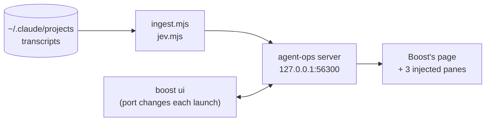

<div align="center">

# 🧭 agent-ops

**See what your Claude Code agents cost, and steer them to the cheapest model that does the job.**

[](LICENSE)


</div>

agent-ops adds three panes to JFrog Boost's local dashboard and ships the rules
that decide which model each workflow agent runs on. It is not tied to any project: the rules apply
everywhere, and the panes read every project's transcripts.

| | What it does | Where |
|---|---|---|
| 📊 **Agent usage** | Every assistant message as API-equivalent cost or tokens, one bar per day | `dashboard/usage-panel.js` |
| 🎯 **Model routing** | Which model and effort each subagent ran on, what it cost, how its reviews held up | `rules/`, `templates/`, `dashboard/panel.js` |
| 🧩 **Skill router** *(optional)* | Whether the `jev-skill-suggestion` plugin saves context tokens or costs them | `dashboard/jev-panel.js` |

Everything runs on your machine. Nothing here calls a model or sends data anywhere: it only reads the
transcripts Claude Code already writes.

---

## Contents

[Requirements](#requirements) · [Install](#install) · [The dashboard](#the-dashboard) ·
[Model routing](#model-routing) · [Skill router](#skill-router) · [What the figures mean](#what-the-figures-mean) ·
[Configuration](#configuration) · [Troubleshooting](#troubleshooting) · [Layout](#layout) · [License](#license)

---

## Requirements

| Need | Why |
|---|---|
| **Windows 10 / 11** | The autostart is a Scheduled Task launched through `wscript`; the server finds Boost with `tasklist` and `netstat`, and opens the page with `rundll32`. Boost's price table is read from `%LOCALAPPDATA%\boost`. It has only been run on Windows. |
| **Node.js 22.13 or newer** | The usage database is Node's built-in `node:sqlite`, which is only available without a flag from 22.13. That is also why there is no `npm install`: the project has no dependencies. |
| **[Claude Code](https://claude.com/claude-code)** | It writes the session transcripts (`~/.claude/projects/**`) that every figure is computed from, and its Workflow tool is what the routing rules and `templates/route.js` are written for. |
| **JFrog Boost**, with `boost ui` running | The panes are injected into Boost's own page rather than a second dashboard, and prices come from Boost's `litellm-prices.json`. The server proxies the running `boost ui`; Boost's binary is never modified, so a Boost update cannot erase the panes. Without Boost the page shows "Boost dashboard not found". |
| *Optional:* the **`jev-skill-suggestion`** plugin | Only the Skill router card needs it; see [Skill router](#skill-router). Without it that card has nothing to show and the other two are unaffected. |

---

## Install

```powershell
git clone <this repo> agent-ops
cd agent-ops
.\install.ps1            # registers the "agent-ops" logon task; -Port 56300 by default; no admin needed
```

Then, **once**, open <http://127.0.0.1:56300/> and switch **Model routing** *On* (see
[Switches](#switches)). That installs the rule that tells new Claude Code sessions to route their
workflow agents; `install.ps1` does not do it for you.

From then on the server starts at logon and opens that page whenever a new `boost ui` starts.

```powershell
.\uninstall.ps1          # removes the task and stops the server; leaves the code and dashboard\routing.db
```

---

## The dashboard

**Open <http://127.0.0.1:56300/>**, not the port `boost ui` prints: that one is Boost's page without
the panes.



The server finds `boost ui` (from `boost.exe`'s listening ports, or `BOOST_URL`), proxies it, and
injects scripts into the page. It binds to `127.0.0.1` only.

### Agent usage

Every assistant message in every transcript, as API-equivalent cost or tokens, one bar per day like
Boost's chart. **Colour** is the model; **fill** is the kind of agent:

| Fill | Meaning |
|---|---|
| ▇ solid | chats |
| ▒ faded | Agent-tool subagents started from a chat |
| ▨ hatched | Workflow agents |

The legend hides and shows series, as Boost's does. Transcripts are read by byte offset, so only
appended lines are parsed (a first read of ~800 MB takes about 5 s, then well under a second). A
message still streaming is left for the next pass, since only its last line carries the final output
count.

### Model routing card

Which model and reasoning effort every subagent ran on, what it cost, and how its reviews held up.
The headline adds two savings:

- **Model:** the tokens priced at Opus 5.5, minus the actual cost.
- **Effort (estimated):** an agent below the session's default effort (`xhigh`), compared with the
  average output tokens of the same role at `xhigh`, priced at its model's output rate. Needs 3+
  reference agents.

Effort is read from the transcripts, where every assistant line records it. `ingest.mjs` reads
`~/.claude/projects/*/*/subagents/**` into `dashboard/routing.db` (SQLite), incrementally;
`node dashboard/ingest.mjs --rebuild` starts over.

### Switches

Each card has an On/Off switch (`toggles.mjs`). Both act on **new** sessions only; a running session
keeps what it loaded.

| Switch | On | Off |
|---|---|---|
| **Model routing** | Writes `~/.claude/rules/model-routing.md` from `rules/global-pointer.md`, with `{{AGENT_OPS_DIR}}` replaced by wherever you cloned this repo | Removes that file. Scripts already written keep the models they name |
| **Skill router** | Removes `enabledPlugins["jev-skill-suggestion@skills-dir"]` from `~/.claude/settings.json` | Sets it to `false` (checked headlessly: the plugin's hooks module is then not loaded) |

A round trip leaves `settings.json` byte-identical. The switch endpoint only answers this page: it
checks the Host header and a same-origin Origin, and requires an `x-agent-ops` header that a
cross-origin page cannot send without a preflight the server never grants.

### Live updates and period

- All panes poll every 10 s and redraw only when a figure changed, never under the pointer (a redraw
  would drop the hover and its tooltip, so it waits until the pointer leaves).
- The server re-reads new transcript lines at most every 8 s.
- Panes follow Boost's period selector (`period.js` reads Boost's `boost.report.days` and watches the
  period Boost's page asks its API for), and show a pulsing skeleton while loading.

### Starts with Boost

`install.ps1` registers a logon task that runs the server hidden through `run.vbs` (which blocks, so
the task reads *Running* and restarts on failure). The server polls every 5 s for a `boost ui`; when
one appears on a port it has not seen, it opens this page. If `boost ui` also opens its own page you
get two tabs; this is the one with the panes. `ROUTING_NO_OPEN=1` stops the auto-open.

---

## Model routing

`rules/model-routing.md` says which model and reasoning effort each kind of workflow agent should get,
instead of running everything on Opus at the session's effort:

| Role | Model | Effort |
|---|---|---|
| Implementer | Opus | high |
| Adversarial correctness review | Opus | xhigh |
| Fixer | Opus | high |
| Review against written criteria | Sonnet | medium |
| Documentation writer / reviewer | Haiku | low |

It also covers escalating risky paths, per-chunk overrides and the labelling the dashboard needs to
score agents. **Routing itself lives in each workflow script**: paste `templates/route.js` (the
`ROUTES` table and `route()`) into the script and set `RISKY` for your project. If every labelled
agent on the card shows Opus, no script using `route()` has run in that period.

---

## Skill router

> **Optional. Skip it if you don't use the plugin.**

**What the plugin does.** Claude Code puts a listing of every installed skill (name and description)
into the context of every session, so a large skill collection becomes a large prefix that rides along
on every turn. The `jev-skill-suggestion` plugin
withholds that listing and asks a decision model (Jev) to pick at most one skill for each prompt,
then injects only that skill's body.

**Why there is a card for it.** That is a trade: tokens not spent on the listing, against tokens spent
on injected skill bodies. The plugin also fails open, so a wrong config makes it stop suggesting
anything without a single error. The card measures the trade and checks the config, so you can see
whether the plugin is paying for itself instead of assuming it is:

- listings withheld against skill bodies injected, in prefix tokens;
- health checks on its configuration;
- which skills are offered and which are actually called.

**Using it.** The plugin has to be installed under the id `jev-skill-suggestion@skills-dir` (for
example `npx claude-code-templates@latest --mod productivity/jev-skill-suggestion`); that is the id
the card reads and the switch toggles. `jev.mjs` re-reads changed transcripts every 5 minutes
(`JEV_INTERVAL_MS`), caching per file in `dashboard/data/`, and also runs alone:
`node dashboard/jev.mjs` prints the headline.

The plugin itself talks to an external decision service; that is the plugin's behaviour, not
agent-ops's. The card only reads your local transcripts and settings, and never renders an API key.

---

## What the figures mean

| Figure | Kind | How |
|---|---|---|
| Model routing costs | *derived, not billed* | recorded tokens × API list price from Boost's table. "Saved" prices each non-Opus agent's tokens at Opus 5.5 (an Opus agent is its own baseline). A model missing from the table is priced at its family's previous release and flagged on the card |
| Effort savings | *estimated* | output tokens against the same role's average at `xhigh` (see above) |
| Skill router counts | *measured* | turns, calls, timestamps |
| Skill router tokens | *estimated* | characters ÷ 4. A block added to the conversation costs its size × the turns it then rides in the prefix, until the next compaction; a withheld listing is valued the same way. With a period selected, a session active in it is counted whole |

Skill-router health and configuration always describe the present. Whether a suggestion was *good* is
not judged. None of these figures is a bill.

---

## Configuration

| Variable | Default | Effect |
|---|---|---|
| `ROUTING_PORT` | `56300` | Port the server listens on (set for you by `install.ps1 -Port`) |
| `BOOST_URL` | *found automatically* | Point at a `boost ui` instead of discovering it |
| `ROUTING_NO_OPEN` | *unset* | `1` stops the page opening when `boost ui` starts |
| `JEV_INTERVAL_MS` | `300000` | How often the skill router re-reads changed transcripts |

---

## Troubleshooting

```powershell
Get-ScheduledTask -TaskName agent-ops | Select-Object TaskName, State   # Running is healthy
Get-Content .\dashboard\server.log -Tail 20
```

| Symptom | Likely cause |
|---|---|
| "Boost dashboard not found" | No `boost ui` is running yet. Start it and reload |
| Panes missing | You opened the port `boost ui` printed. Use `http://127.0.0.1:56300/` |
| Everything on the routing card is Opus | No workflow script using `route()` has run in that period |
| Skill router card is empty | The plugin isn't installed as `jev-skill-suggestion@skills-dir`, or hasn't run a session yet |

---

## Layout

```text
agent-ops/
├── rules/
│   ├── model-routing.md     which model and effort for which role, escalation, labelling
│   └── global-pointer.md    template for ~/.claude/rules/model-routing.md (filled in by the switch)
├── templates/route.js       the ROUTES table and route() to paste into a workflow script
├── dashboard/               the server and the injected panes (no dependencies)
├── docs/spec-jev-card.md    the spec the skill-router card, period following and autostart were built from
├── install.ps1              register the logon task
└── uninstall.ps1            remove it
```

---

## License

[GNU Affero General Public License v3.0](LICENSE) (AGPL-3.0). If you run a modified version as a
network service, you must offer its source to the people using it.
